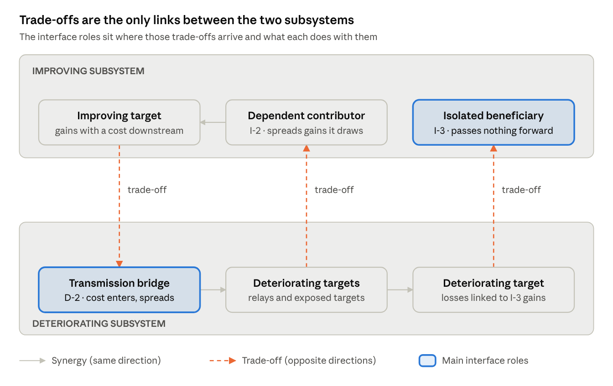
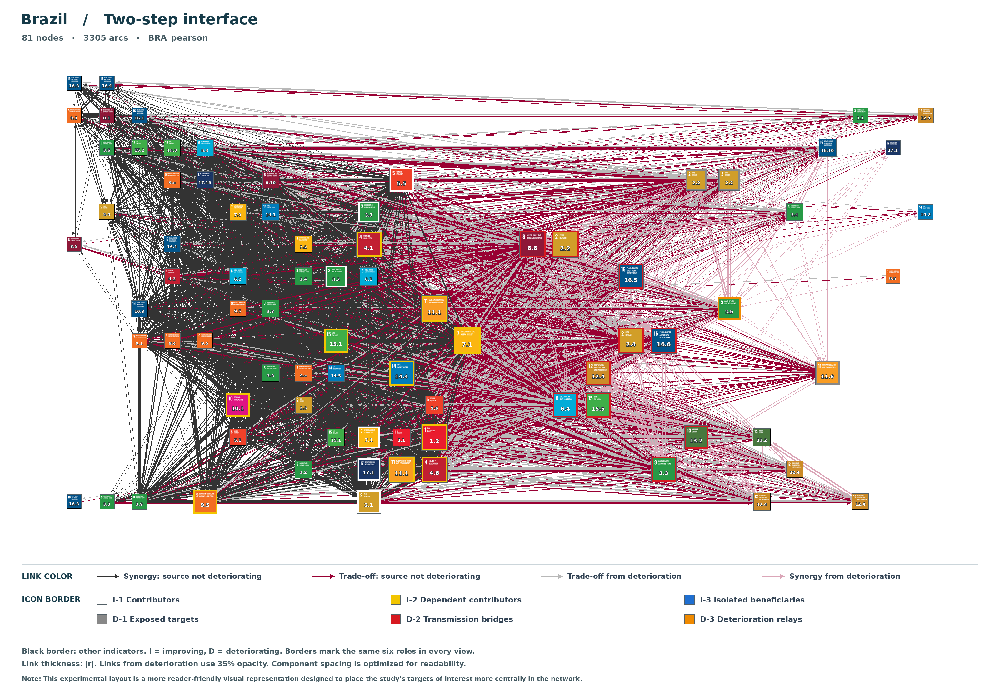

# Beyond Co-movement: Performance Direction and Transmission Roles in SDG Interlinkage Networks

Walter Antonio Desiderá Neto · Draft, November 2026

## Abstract

Synergies and trade-offs among Sustainable Development Goal (SDG) targets are usually inferred from the sign of associations between normatively oriented indicators. This article argues that such networks cannot be interpreted, nor their links correctly classified, without the direction of observed performance. Two indicators that deteriorate together are positively associated, yet their reinforcement is not a contribution to the 2030 Agenda. The argument builds on an application to Brazil's 2024 Voluntary National Review, which used the approaches then available, the IGES tool and the JRC compilation, and, on examining target progress, raised the point that neither considers the direction of performance when classifying interlinkages (Desiderá Neto et al., 2025).

We propose a framework in which performance direction enters link classification, node metrics and role selection. Once links are classified this way, synergies connect targets moving in the same direction, and trade-offs become the only links crossing between an improving and a deteriorating subsystem. The main contribution of network analysis then lies at this interface. It can identify transmission bridges, deteriorating targets that receive trade-offs from improving targets and pass deterioration on through synergies, and isolated beneficiaries, improving targets that gain through trade-offs from deteriorating targets while passing forward less synergy than they receive. Neither role is visible to centrality measures or to target-by-target monitoring.

The framework is implemented in an open repository with two procedures: literature-based IGES/JRC relationships with United Nations indicators, and annual SDG Index component scores with exploratory temporal orientation. A synthetic worked example shows how the reading of each target changes once performance direction enters the classification. An application to Brazil's SDG Index components identifies ten transmission bridges, with very different times to the lower boundary, and no isolated beneficiaries. The roles are hypotheses for causal investigation and policy adjustment, not estimated effects.

**Keywords:** Sustainable Development Goals; synergies; trade-offs; policy coherence; network analysis; transmission; monitoring and evaluation.

## 1 Introduction

The indivisibility of the 2030 Agenda is a problem for both monitoring and public action. Progress is assessed target by target, yet the processes behind outcomes cross sectoral boundaries. An intervention may advance several objectives, meet constraints originating elsewhere, or improve one outcome at the expense of another. Network analysis has become a common way to represent these interdependencies (Issa, Mezher and El Fadel, 2024; Chaniotakis et al., 2024).

Its relevance depends on what its links mean. Synergies matter because mutually reinforcing improvements multiply the benefits of public action; trade-offs matter because gains in one domain may involve losses in another. Most quantitative applications operationalise these concepts through the sign of correlations between indicators oriented so that higher values are better (Pradhan et al., 2017; Zhou and Moinuddin, 2017). Orientation makes scales normatively comparable. It does not establish whether the observed trajectories are improving or deteriorating.

This gap has two consequences, which structure the article.

1. **Without performance direction, the network cannot be operationalised meaningfully, nor can its links be properly classified.** A positive association between two deteriorating targets is labelled a synergy, and a target that drags its neighbours backwards is ranked as a leading contributor. Rankings built on such links answer a question nobody asked.
2. **With performance direction, network analysis gains a contribution of its own.** Classified links separate an improving subsystem from a deteriorating one and expose the trade-off arcs that connect them. Two roles at this interface matter most for policy: **transmission bridges**, which carry the cost of others' gains into the deteriorating subsystem and propagate it, and **isolated beneficiaries**, whose improvement is associated with others' deterioration and is not passed on.

The argument builds on an application to Brazil's 2024 Voluntary National Review (VNR), documented in Ipea's Technical Note Dinte 77 (Desiderá Neto et al., 2025). The note applied the approaches recommended to countries at the time, the IGES tool and the JRC compilation, and proposed two network categories based on weighted degree. When target progress could be examined, it raised a point that neither framework addresses: the meaning of synergy and trade-off depends on whether the targets involved are improving or deteriorating. This article develops that finding into a complete operational framework and shows where its added value lies.

Section 2 reconstructs the VNR exercise and the finding that motivates this article. Section 3 positions the framework within the literature and examines the evidential basis of literature-derived networks. Section 4 sets out the analytical design. Section 5 defines the metrics and roles, with emphasis on the interface roles. Section 6 presents a worked illustration and an application to Brazil. Sections 7 and 8 discuss implications for investigation and policy, and limitations. Section 9 concludes.

## 2 Starting point: the Brazilian VNR exercise and its finding

### 2.1 The original application

Brazil's 2024 VNR replicated the IGES SDG Interlinkages Analysis and Visualisation Tool (Zhou and Moinuddin, 2017). The IGES relationships and their directions were kept unchanged. Indicator availability limited the network to 73 targets observed annually over 2010–2023, with gaps imputed by compound annual growth rates. Every assumed link was weighted and classified by its Pearson coefficient, regardless of strength, significance or the distribution of the series (Desiderá Neto et al., 2025).

The complete network was too dense to read, so it was filtered into separate synergy and trade-off subnetworks. The synergy subnetwork showed two clusters, with targets 10.1, 9.4 and 8.5 apparently bridging the transmission of positive effects between them. The trade-off subnetwork qualified that reading: the same targets, particularly 9.4, were also major receivers and senders of trade-offs. A role suggested by one subnetwork could be contradicted by the other.

That observation motivated two metrics built from weighted in- and out-degree in each subnetwork:

```latex
\mathrm{SL.Out}_i = \mathrm{CGP.Out.S}_i - \mathrm{CGP.Out.T}_i, \qquad \mathrm{TL.In}_i = \mathrm{CGP.In.T}_i - \mathrm{CGP.In.S}_i
```

Targets with positive SL.Out were labelled *transversal collaboration* ("helping without hindering"); targets with positive TL.In were labelled *transversal neglect* ("hindered without being helped"). A weighting factor based on each node's share of links was added, to flag targets whose centrality might reflect uneven research coverage rather than interdependence.

### 2.2 What the examination of progress revealed

When target-level progress data became available, the note examined what the categories could and could not show. The note reasoned through a hypothetical network in which 90% of targets were strongly synergistic with one another while one target held trade-offs with all of them. If the synergistic targets were regressing together while the isolated target advanced rapidly, the "transversal collaborators" would be dragging the system backwards. Their synergy would operate in the direction opposite to the one desired.

The reverse also held. A target with high TL.In but improving performance could not be described as neglected. It was more plausibly pursued through individualised strategies, indifferent to the rest of the plan, such that deterioration elsewhere contributed to its own progress. The note read this as a possible sign of concentrated misallocation of scarce resources (Desiderá Neto et al., 2025).

The note drew two conclusions. First, positive performance is not an intrinsic attribute of synergy: with links classified by the sign of association alone, as in the available methods, network positions cannot be read as contribution or neglect. Second, performance has three dimensions that must be kept apart: **stage** (distance to the target), **direction** (approaching or moving away) and **pace** (speed of change). Its literature search found studies that consider the stage of achievement as a limit on a target's capacity to transmit synergies. It found none that examined how the *direction* of performance changes the meaning of synergy and trade-off.

### 2.3 From diagnosis to framework

This was the note's central contribution. The IGES tool and the JRC compilation were the interlinkage approaches suggested to countries preparing VNRs, and neither incorporates the direction of target performance into the classification of interlinkages. By applying them in full, reporting openly what their metrics could and could not support, and identifying performance as the missing element, the note took the first step towards the framework presented here. The present framework carries that step through every stage of the analysis. The changes are summarised below; Sections 4 and 5 justify each one.

| Element | NT Dinte 77 (2025) | Present framework |
| --- | --- | --- |
| Link evidence | IGES links, all retained regardless of significance | IGES/JRC evidence rules with p ≤ 0.10, or SDG Index associations with p < 0.10 and temporal orientation |
| Series preparation | One indicator per target, CAGR imputation | Coverage-based series selection, bounded CAGR imputation, consolidation of shared series |
| Link classification | Sign of the oriented correlation | Sign of the oriented correlation, then checked against both nodes' trajectories; weak discordant links excluded, others reclassified |
| Contribution metric | SL.Out = out-synergy − out-trade-off | Colab, same formula, read only among improving nodes |
| Exposure metric | TL.In = in-trade-off − in-synergy | Neglect = in-trade-off **+** in-synergy from deteriorating sources, read only among deteriorating nodes |
| Interface measures | None | Trade-off received and sent across the interface, synergy passed on, bridge and relay flows, forward ratio φ |
| Roles | Two categories | Six roles defined by performance direction, including the two interface roles |
| Context | None | Semantic ambitiousness (IGES/JRC) or conditional time to boundary (SDG Index), reported for every role |
| Coverage bias | Link-share weighting factor | Same factor, IGES/JRC only, produced as a parallel weighted version with a rank comparison (Section 5.6) |

The change in the exposure metric is the clearest consequence of incorporating performance. TL.In *subtracted* incoming synergies on the assumption that any synergy is help. Neglect *adds* incoming synergies from deteriorating sources, because reinforcement from a deteriorating neighbour is a source of pressure, not support.

The link-share weighting factor is retained for the IGES/JRC procedure, where links come from literature inventories and coverage bias can arise. It is applied as a parallel version rather than a correction, so that positions that change markedly can be flagged (Section 5.6).

## 3 Position in the literature and evidential foundations

### 3.1 How synergies and trade-offs are usually operationalised

Reviews group methods for inferring SDG interlinkages into qualitative, literature-review and quantitative traditions (Chaniotakis et al., 2024). Qualitative scoring, such as the seven-point scale of Nilsson et al. (2017), captures context but lacks explicit criteria for each score. Literature compilations, such as the JRC inventory (Miola et al., 2019; Fronza et al., 2023), accumulate findings across studies but describe relationships that may not hold uniformly across settings. Quantitative studies correlate indicator series: Pradhan et al. (2017) define synergies and trade-offs from the sign of correlations between oriented indicators, and Kroll, Warchold and Pradhan (2019) examine how these classifications shift over time.

These approaches share a premise: once indicators are oriented so that higher is better, a positive association means mutual support. This premise holds only when both indicators improve. When both deteriorate, the same coefficient describes reinforcement of deterioration. Studies that follow classifications over time ask whether a relationship changes sign, not whether the outcomes it links are moving towards or away from their targets.

### 3.2 The limits of centrality

Network applications typically rank targets by degree, betweenness, eigenvector or closeness centrality (Issa, Mezher and El Fadel, 2024). Weighted in- and out-degree are the most common because they are simple and separate sending from receiving. Issa, Mezher and El Fadel recommend composite indices to balance the distortions of single measures. Composite indices still treat all synergy weight as favourable. A target can be central because it accompanies widespread improvement, because its deterioration accompanies deterioration elsewhere, or because it sits where gains and losses meet. These positions call for different responses, and no combination of centralities distinguishes them without performance direction.

Decision-makers also value simplicity and direct applicability over methodological sophistication (Di Lucia, Slade and Khan, 2022). A framework that translates network positions into a small number of interpretable roles, each tied to a specific question, addresses that demand without hiding the underlying evidence.

### 3.3 Evidential basis of literature-derived networks

The IGES tool combines relationships drawn from a union of reference sources with country-specific indicator correlations (Zhou and Moinuddin, 2017). The JRC compilation records interaction types, directions, methods and contexts, including cases where direction cannot be established (Fronza et al., 2023). The literature supplies the existence and orientation of candidate relationships; local correlations supply their strength. Correlations do not independently establish direction. Uneven research coverage may also make well-studied targets appear more connected (Desiderá Neto et al., 2025); the IGES/JRC procedure therefore also produces a link-share weighted version (Section 5.6).

Comparing the two inventories shows how sensitive the network is to construction choices. The consolidated comparison contains 8,751 IGES records and 5,701 JRC records, with 3,133 matches: 35.80% of the former and 54.96% of the latter.

**Table 1.** Directional agreement among matched IGES and JRC records

| Directional evidence | Records | Share of matched records | Treatment in the network |
| --- | --- | --- | --- |
| Uncertain in the JRC evidence | 1,286 | 41.05% | Both directions retained, unless IGES codes clear one-sided evidence in the reverse direction |
| Complete agreement | 1,171 | 37.38% | Retained as coded |
| Partial agreement | 597 | 19.06% | Both directions retained |
| Opposite unidirectional orientations | 79 | 2.52% | Both directions retained; conflicting evidence recorded |
| Total | 3,133 | 100.00% |  |

*Note:* Complete agreement denotes the same single direction or bidirectionality in both inventories; partial agreement denotes a single direction in one and bidirectionality in the other. Percentages are rounded independently. Counts refer to relationship records, not unique unordered target pairs. The consolidated comparison permits verification of totals but does not independently reproduce the matching of the underlying inventories. Source: Zhou and Moinuddin (2017); Fronza et al. (2023).

These differences are not an error rate. An unmatched relationship may reflect scope, coverage or coding, and the JRC compilation is not an exhaustive standard. What the comparison does establish is that a credible framework must state how each category of directional evidence becomes an arc. The last column of Table 1 makes this explicit, so that alternative rules can be tested in replication.

Each direction of a pair is evaluated separately. Clear JRC evidence for a direction (single-sided or double-sided) always retains it. A direction is rejected when the pair is absent from both inventories; when it appears in only one inventory and that inventory codes the reverse direction as one-sided; or when IGES codes the reverse direction as one-sided clear and JRC codes the reverse direction as single-sided or the pair as unclear. All other directions are retained, and every arc records the evidence from both sources. In practice, unresolved disagreement is represented by two arcs rather than settled by choosing one source.

## 4 Analytical design

### 4.1 Two procedures for building the network

**IGES/JRC procedure.** Candidate target relationships come from the IGES inventory, assessed against JRC evidence on direction (Table 1). Observations are collected from the UNSD SDG database by geographic code (M49), for a country or region. For each target, the series with the greatest number of distinct original numeric years during 2000–2025 is selected, with ties broken by IGES order. Eligible gaps are filled by series-specific compound annual growth rates computed from positive endpoint pairs, with bounds applied to generated values. Series shared by several targets enter the calculations through one representative target, so identical observations are not counted as independent evidence of interdependence. Eligible pairs receive Pearson coefficients and are retained at p ≤ 0.10.

**SDG Index procedure.** The SDG Index (Sachs et al., 2026) is distinct from the official UN framework. It combines indicators from several sources on a normalised 0–100 scale, where 100 is an operational benchmark rather than full attainment of a UN target. The procedure uses annual component scores rather than goal or overall scores, for 169 countries and 14 regions or aggregates. An editorial mapping links 101 components to SDG targets. Pairs within the same goal or target are excluded before testing. Retained pairs need at least eight matched observations, a nonzero coefficient (Pearson, Spearman or both) and nominal p < 0.10. Benjamini–Hochberg q-values are kept for sensitivity analysis.

In the SDG Index procedure, orientation is exploratory. A direction is supported when both a lagged association and a conditional association, controlling for the recipient's previous value, reach p < 0.10. A single arc is kept when only one direction is supported. Two arcs are kept when both directions are supported or neither can be distinguished, and the two situations are recorded separately.

### 4.2 Performance direction

Improvement means movement towards the desired outcome; deterioration means movement away from it. Neither term says whether a target has been achieved or is on track for 2030. Following the three dimensions identified in Section 2.2, the framework uses **direction** to classify links, and uses **stage** and **pace** as context reported for every role (Section 5.4). This separation is consistent with the UN progress assessment, which evaluates change against target requirements (United Nations, 2026a, 2026b), but the framework does not reproduce its categories.

For each series, a linear trend is fitted over the analytical period and its slope multiplied by the desired direction *d*: +1 when an increase is favourable, −1 when a decrease is favourable. SDG Index scores already ascend normatively, so *d* = +1.

```latex
x_i(t) = \alpha_i + \beta_i t + \varepsilon_i(t), \qquad \beta_i^{*} = d_i \beta_i, \qquad d_i \in \{-1, +1\}
```

Positive and negative adjusted slopes indicate improvement and deterioration. A numerically negligible fitted change is classified as stable, and fewer than three distinct years as undetermined. The trend R² measures how closely observations follow the fitted trajectory; it says nothing about the causal validity of any relationship.

### 4.3 Classifying links with performance

Initial link types come from the sign of the oriented association. Each retained link is then checked against the trajectories of its two nodes. A link is *discordant* when its initial type conflicts with those trajectories: for example, a positive oriented association between an improving and a deteriorating node.

Let *m* be the smaller of the two trend R² values and |r| the absolute association. A discordant link is excluded if *m* < 0.10, or if *m* < 0.20 and |r| < 0.40. Weak trends cannot carry a reclassification, and weak associations cannot withstand one. Other discordant links between nodes with defined directions are reclassified to match the trajectories. The original coefficient and initial type are preserved in an *Adverse cases* record; link weights use |r|. Links involving stable or undetermined nodes keep their initial type.

**Table 2.** Retained links by the trajectories of their nodes

| Source | Recipient | Type | Interpretation (hypothesis) |
| --- | --- | --- | --- |
| Improving | Improving | Synergy | Reinforcement of improvement |
| Deteriorating | Deteriorating | Synergy | Reinforcement of deterioration |
| Improving | Deteriorating | Trade-off | The source's gains are associated with the recipient's losses |
| Deteriorating | Improving | Trade-off | The recipient's gains are associated with, and may be sustained by, the source's losses |

*Note:* Interpretations are hypotheses about relationships, not estimated causal effects. Arcs keep their literature-based or temporal evidential status.

The last two rows describe opposite situations. In the third, the improving node is the source and the cost falls downstream. In the fourth, the improving node is the recipient, and its improvement may depend on deterioration upstream. This is the configuration NT Dinte 77 identified as possible concentrated misallocation. Keeping the two rows distinct is what allows the interface roles of Section 5.

### 4.4 What the network adds beyond co-movement

Reclassification makes one property hold by construction. Among nodes with defined directions, synergies connect nodes moving in the same direction and trade-offs connect nodes moving in opposite directions. The classified network therefore splits into two synergy subsystems, one improving and one deteriorating, joined only by trade-off arcs (Figure 1, Section 5).

This is a design feature, not a finding. A concentration of synergies within groups of the same direction cannot be offered as evidence that those groups are causal systems. The information the network adds over a simple list of improving and deteriorating targets lies elsewhere:

- **which** pairs are linked at all, as established by literature evidence or statistical filters;
- **the orientation** of each link, from literature or temporal tests;
- **the strength** of each link;
- **the structure of the interface**: which nodes receive the trade-off arcs that cross between subsystems, and what they do with them.

The last item is where network analysis contributes something that target-by-target monitoring cannot. A list of deteriorating targets does not show which of them absorb the cost of gains elsewhere and pass it on. A list of improving targets does not show which of them improve at the expense of others while sending nothing forward.

## 5 Metrics and network roles

### 5.1 Contribution and exposure

With links classified by performance, each metric is read only within the performance group where its meaning is unambiguous. Let *w(i,j)* be the weight of the arc from *i* to *j*, and let *I* and *D* denote the improving and deteriorating subsystems.

**Collaboration** keeps the form of the SL.Out metric of NT Dinte 77 but is read only among improving nodes, where outgoing synergies reach other improving nodes and outgoing trade-offs reach deteriorating ones:

```latex
\mathrm{Colab}(i) = \sum_{j:\,\text{synergy}} w(i,j) - \sum_{j:\,\text{trade-off}} w(i,j), \qquad i \in I
```

**Neglect** replaces TL.In and is read only among deteriorating nodes. Incoming trade-offs come from improving sources; incoming synergies from deteriorating sources are added, not subtracted:

```latex
\mathrm{Neglect}(k) = \sum_{i:\,\text{trade-off}} w(i,k) + \sum_{j \in D:\,\text{synergy}} w(j,k), \qquad k \in D
```

Neither name implies intent. "Neglect" denotes a concentration of adverse incoming relationships, not deliberate institutional neglect or insufficient spending. Neither metric estimates the marginal return to an intervention.

### 5.2 Interface measures

Aggregate scores hide where adverse pressure comes from. Neglect mixes pressure from the improving subsystem (trade-offs) with pressure from within the deteriorating one (synergies). The framework therefore separates the components that describe traffic across the interface:

| Measure | Defined for | Meaning |
| --- | --- | --- |
| T⁺(k) | k ∈ D | Incoming trade-off weight from improving sources: the cost of others' gains arriving at k |
| S⁻(k) | k ∈ D | Incoming synergy weight from deteriorating sources |
| B(k) | k ∈ D | Outgoing synergy weight to deteriorating nodes: what k passes on |
| R(i) | i ∈ I | Incoming trade-off weight from deteriorating sources: gains associated with others' losses |
| Sₒ(i) | i ∈ I | Outgoing synergy weight to improving nodes: what i passes forward |
| C(i) | i ∈ I | Outgoing trade-off weight to deteriorating nodes: the cost of i's gains downstream |

Only links between nodes with defined directions enter these measures; links from stable or undetermined nodes do not.

Two-step flows follow directly. The total weight of all paths that enter a deteriorating node *k* as a trade-off from an improving node and leave as a synergy to a deteriorating node is the product of the two sums:

```latex
\mathrm{Bridge}(k) = \sum_{i \in I} \sum_{j \in D} w(i,k)\,w(k,j) = T^{+}(k) \times B(k)
```

The analogous flow within the deteriorating subsystem, Relay(k) = S⁻(k) × B(k), describes deterioration received from and passed to other deteriorating nodes. For improving nodes, the forward ratio φ(i) = Sₒ(i) / R(i) indicates how much of what a node gains from others' losses is matched by synergies it passes on. A value of zero means nothing is passed forward; the framework treats φ < 1, passing forward less than is received, as isolation.

### 5.3 Six roles

Roles combine rankings rather than relying on a single score. Each ranking uses the top 10 nodes with positive values within the relevant performance group. Intersections are not refilled with lower-ranked cases.

| Role | Group | Selection | Question it raises |
| --- | --- | --- | --- |
| **I-1 Contributor** | Improving | Top Colab, not top R, not top C | How can these beneficial interactions be sustained or extended? |
| **I-2 Dependent contributor** | Improving | Top R with φ ≥ 1 | Do the gains that this node spreads depend on losses elsewhere? |
| **I-3 Isolated beneficiary** | Improving | Top R with φ < 1 | Is this improvement sustained by deterioration elsewhere and kept rather than shared? |
| **D-1 Exposed target** | Deteriorating | Top Neglect, not top B, not D-2 or D-3 | Where does the pressure come from, and can it be contained? |
| **D-2 Transmission bridge** | Deteriorating | Top Bridge(k) | Does the cost of others' gains enter the deteriorating subsystem here and spread? |
| **D-3 Deterioration relay** | Deteriorating | Top Relay(k), not D-2 | Is deterioration reproduced here and passed on? |

Each node receives at most one role. I-2 and I-3 split the top receivers by φ, I-1 excludes them and the top senders of costs, and D-2 takes precedence over D-3 and D-1. Excluding top senders of costs from I-1 matters: a target whose gains are associated with losses downstream is the origin of what bridges propagate, and should not be labelled a contributor without qualification. The roles are not a ranking of the intrinsic worth of targets, and not every relevant target falls into one. They separate questions that a single centrality measure would conflate, while the full network stays available for scrutiny.

### 5.4 Context: characterising roles

Direction alone does not capture what a target demands. Context therefore characterises every role, using a measure suited to each procedure; it does not determine membership.

In the IGES/JRC procedure, the context is **semantic ambitiousness**: the strength of the commitment expressed in a target's wording (Mustajoki et al., 2022). A commitment to eradicate a deprivation is more demanding than one to reduce it, whatever the setting. Within a role, high ambitiousness marks improvement on a demanding commitment, and low ambitiousness marks deterioration despite a modest one. Semantic ambitiousness differs from relative ambitiousness (distance to target) and absolute ambitiousness (effort required), and the target-level coding is distinct from the goal-level aggregates reported by Mustajoki et al.

In the SDG Index procedure, the common scale allows a measure of **stage and pace** together. Using the latest score *S* and the fitted slope:

```latex
T_{100} = \frac{\max(0,\,100 - S)}{\beta}, \;\; \beta > 0; \qquad T_{0} = \frac{\max(0,\,S)}{|\beta|}, \;\; \beta < 0
```

Every selected node is reported with its T₁₀₀ or T₀. These times rank urgency within each role: a transmission bridge close to the lower boundary is more urgent than one deteriorating slowly. These are conditional extrapolations at the fitted pace, not forecasts. A long T₀ means slow deterioration relative to the remaining score, not demonstrated resilience to shocks.

### 5.5 The interface roles as the main contribution

Two roles carry the contribution that only a network can make, and they mirror each other across the interface (Figure 1).



**Figure 1.** After classification, synergies stay within each subsystem and trade-offs cross between them. A transmission bridge receives the cost of gains upstream and spreads it; an isolated beneficiary receives gains associated with losses elsewhere and passes nothing on.

A **transmission bridge** (D-2) is a deteriorating target that receives trade-offs from improving targets and passes deterioration on through synergies. It is where the cost of gains elsewhere enters the deteriorating subsystem and spreads. Selecting it by Bridge(k), rather than by total Neglect, matters: a node can receive little pressure overall yet be the main point of entry and propagation. Conversely, a node with high Neglect may receive and pass on deterioration entirely within the deteriorating subsystem, which makes it a relay, not a bridge.

An **isolated beneficiary** (I-3) is an improving target that receives trade-offs from deteriorating targets and passes forward less synergy than it receives (φ < 1). Its improvement is associated with losses elsewhere and largely stays where it is. This is the configuration that NT Dinte 77 interpreted as individualised strategies and possible concentrated misallocation. It differs from a dependent contributor (I-2), which also gains from others' losses but passes forward at least as much as it receives (φ ≥ 1). Isolation is defined by the balance at the node rather than by rank, because in dense networks almost every receiver also sends substantial synergy.

The two roles define the most specific policy questions in the framework. At a bridge, the question is whether interrupting the transmission would prevent wider deterioration without sacrificing the upstream gains. At an isolated beneficiary, the question is whether the gains could be maintained with fewer losses elsewhere, or redistributed so that they reach other targets.

The repository computes all six roles and exports every interface measure, rank and context value, so membership can be audited and alternative cut-offs tested. Its Two-step interface view places improving nodes on one side and deteriorating nodes on the other, and moves towards the centre those with the largest two-step flows across the interface, so the interface roles can be read at a glance (Section 6.2).

### 5.6 Link-share weighted version (IGES/JRC)

In literature-derived networks, a target can rank highly because many studies record its links rather than because those links are strong. NT Dinte 77 proposed a factor to flag this: each target's share of the links it sends or receives.

```latex
P_i = \frac{L_i}{\sum_{j=1}^{n} L_j}
```

The IGES/JRC procedure always produces a weighted version alongside the original, with its own workbook and figures. Sent measures (Colab, synergy and trade-off sent) are divided by the sent share, received measures (Neglect, trade-off and synergy received) by the received share, and bridge and relay flows by both; φ is unchanged. Roles, node sizes and Two-step positions are recomputed from the weighted measures. Shares are expressed relative to the mean (Pᵢ × n), so a target with the mean number of links keeps its value; this rescaling does not change any ranking.

The weighted version is a check, not a substitute. A comparison sheet reports original and weighted ranks for Colab and Neglect and flags the discrepancy the NT considered most serious: a target among the top contributors that enters the top of weighted Neglect. Roles that hold in both versions are stronger candidates for investigation. The SDG Index procedure has no weighted version: its links are estimated from data for every eligible pair, so literature coverage does not determine them.

## 6 Worked illustration

### 6.1 Synthetic network

A synthetic network shows how the reading of each node changes once performance direction enters the classification, compared with degree-based categories such as those of NT Dinte 77. It has eight hypothetical targets, A–H: A, B, C and D are deteriorating; E, F, G and H are improving. All 14 retained links are already consistent with the trajectories, as after reclassification. Because the network is small, rankings use the top 3 instead of the top 10; the roles are identical with the top 10.

The links form a sequence across the interface. Improving targets F and E send trade-offs to A (0.4) and B (0.6). A and B pass deterioration on through synergies: A to B (0.8) and C (0.5), B to C (0.7) and D (0.4), C to D (0.6). Deteriorating targets C and D send trade-offs to improving G (0.6 and 0.7), and D to improving E (0.5). Within the improving subsystem, E sends synergies to F (0.8) and H (0.6), F to E (0.5); H sends a trade-off to D (0.3). G sends nothing.

**Table 3.** Degree-based and performance-based metrics for the synthetic network

| Node | Direction | SL.Out (NT) | TL.In (NT) | Colab | R | C | φ | Neglect | T⁺ | B | Bridge | Role |
| --- | --- | --- | --- | --- | --- | --- | --- | --- | --- | --- | --- | --- |
| A | Deteriorating | **1.30** | **0.40** | – | – | – | – | 0.40 | 0.40 | 1.30 | 0.52 | D-2 Transmission bridge |
| B | Deteriorating | **1.10** | −0.20 | – | – | – | – | 1.40 | 0.60 | 1.10 | 0.66 | D-2 Transmission bridge |
| C | Deteriorating | 0.00 | −1.20 | – | – | – | – | 1.20 | 0.00 | 0.60 | 0.00 | D-3 Deterioration relay |
| D | Deteriorating | −1.20 | −0.70 | – | – | – | – | 1.30 | 0.30 | 0.00 | 0.00 | D-1 Exposed target |
| E | Improving | **0.80** | 0.00 | 0.80 | 0.50 | 0.60 | 2.80 | – | – | – | – | I-2 Dependent contributor |
| F | Improving | 0.10 | −0.80 | 0.10 | 0.00 | 0.40 | – | – | – | – | – | None (top sender of costs) |
| G | Improving | 0.00 | **1.30** | 0.00 | 1.30 | 0.00 | 0.00 | – | – | – | – | I-3 Isolated beneficiary |
| H | Improving | −0.30 | −0.60 | −0.30 | 0.00 | 0.30 | – | – | – | – | – | None |

*Note:* Bold marks the nodes the NT Dinte 77 categories would select: the top three positive SL.Out values (transversal collaboration) and the positive TL.In values (transversal neglect). Present metrics are shown only for the performance group in which they are read. Rankings use the top 3 positive values; precedence as in Section 5.3.

**Reading without performance direction.** The two leading "transversal collaborators", A and B, are deteriorating. Their large outgoing synergies spread deterioration, which is precisely the case NT Dinte 77 anticipated in its hypothetical example. The leading "neglected" target, G, is improving: its high TL.In reflects gains associated with losses in C and D, not neglect. A is also selected as "neglected", although its main role is to pass deterioration on.

**What the new roles show.** E remains a contributor, but a dependent one: it spreads synergies to F and H while receiving a trade-off from deteriorating D (R = 0.50). G is an isolated beneficiary: it receives 1.30 of trade-off weight from C and D and passes nothing forward (φ = 0), whereas E passes forward 2.8 times what it receives. F receives no role. Its Colab is positive (0.10), but it is among the top senders of costs to deteriorating targets: its trade-off to A is the entry point of a bridge. Its positive SL.Out would have placed it in NT Dinte 77's transversal collaboration category.

**Why the interface measures matter.** Total Neglect does not single out A: at 0.40 it is the lowest among deteriorating nodes. Yet A is the entry point for F's trade-off and the largest propagator of deterioration (B = 1.30). Bridge(k) identifies A and B as the two points where the cost of gains in F and E enters the deteriorating subsystem. C, by contrast, receives deterioration only from other deteriorating nodes and passes it on: it is a relay, not a bridge.

The illustration shows the full sequence the framework is designed to reveal. Gains in F and E are associated with losses in A and B; these spread to C and D; and losses in C and D are associated with gains in G, which keeps them. Each link is a hypothesis. The sequence specifies which links an investigation should examine first.

### 6.2 Application to Brazil

The SDG Index procedure was applied to Brazil with Pearson coefficients over 2000–2025. The network has 81 connected component indicators, 56 improving and 25 deteriorating, joined by 3,305 arcs. Table 4 lists the roles with their conditional times: years to the upper boundary for improving indicators, years to the lower boundary for deteriorating ones.

**Table 4.** Roles in Brazil's SDG Index network (Pearson, 2000–2025)

| Role | Indicators, in order of score (target; conditional years) |
| --- | --- |
| I-1 Contributors | Women in parliament (5.5; 77.7) · undernourishment (2.1; 0.0) · government spending on health and education (17.1; 41.7) · access to electricity (7.1; 1.2) · neonatal mortality (3.2; 15.6) · adolescent fertility (3.7; 23.5) |
| I-2 Dependent contributors | Clean cooking fuels (7.1; 11.4) · youth literacy (4.6; 3.4) · Gini coefficient (10.1; 88.0) · protected freshwater sites (15.1; 971.6) · urban piped water (11.1; 0.0) · urban slums (11.1; 19.1) · poverty at $4.20/day (1.2; 12.8) · net primary enrolment (4.1; 12.9) · R&D expenditure (9.5; 296.5) · overexploited fish stocks (14.4; 52.8) |
| I-3 Isolated beneficiaries | None |
| D-1 Exposed targets | PM2.5 concentration (11.6; 1,299.8) · child wasting (2.2; 177.3) · child stunting (2.2; 703.8) |
| D-2 Transmission bridges | Labour rights (8.8; 13.4) · adult obesity (2.2; 9.6) · scarce water embodied in imports (6.4; 619.8) · Red List Index (15.5; 77.2) · production-based nitrogen emissions (12.4; 79.5) · human trophic level (2.4; 16.3) · Corruption Perceptions Index (16.5; 58.4) · timeliness of administrative proceedings (16.6; 7.7) · new HIV infections (3.3; 677.1) · CO₂ emissions (13.2; 977.1) |
| D-3 Deterioration relays | Vaccination coverage (3.b; 59.3) |

*Note:* Conditional years are linear extrapolations at the fitted 2000–2025 pace, not forecasts. Scores and ranks for every indicator are exported in the repository's `Interface_measures` sheet. Source: SDG Index component scores (Sachs et al., 2026); authors' calculations.

Three results stand out.

**There are no isolated beneficiaries.** All ten indicators receiving the most trade-off weight from deteriorating sources pass forward more synergy than they receive, with φ between 1.39 (Gini) and 3.18 (poverty). Gains associated with deterioration elsewhere are shared rather than retained. The relevant question therefore concerns the dependent contributors: whether improvements in water, housing, poverty and education rest on processes associated with environmental and institutional deterioration, or merely coincide with them.

**Bridges concentrate in institutions, nutrition and the environment, with very different urgency.** Timeliness of administrative proceedings (7.7 years to the lower boundary), adult obesity (9.6) and labour rights (13.4) are deteriorating fast relative to their remaining scores; CO₂ emissions (977.1) and new HIV infections (677.1) are not. Context does not change membership, but it orders priorities within the role.

**Deterioration is rarely self-contained.** Only vaccination coverage appears as a relay. All 23 deteriorating indicators that pass deterioration on also receive trade-offs from improving indicators, so in this network deterioration is connected to improvement elsewhere rather than self-contained.



**Figure 2.** Brazil, Two-step interface view (SDG Index, Pearson, 2000–2025). Improving indicators are placed on the left and deteriorating indicators on the right; nodes with the largest two-step flows across the interface move towards the centre. Red borders mark transmission bridges, yellow borders dependent contributors, white borders contributors, grey borders exposed targets and the orange border the relay. Positions are a display device and carry no additional evidence.

These results come from a different data source and period than the VNR exercise of NT Dinte 77, and are not directly comparable with its categories. They are exploratory: component scores may contain carried or interpolated values, and associations between trending series may reflect common trends.

## 7 From roles to investigation and policy adjustment

The framework changes the unit of attention. A target matters not only because its performance is poor or its connections numerous, but because of the role its connections suggest. An improving target deserves scrutiny if its gains coexist with losses elsewhere; a deteriorating target deserves attention beyond its own sector if it sits where deterioration enters or spreads.

**At a transmission bridge**, the investigation must establish whether the incoming trade-off and the outgoing synergy belong to the same mechanism. Temporal ordering, sectoral evidence, institutional arrangements and alternative explanations must be examined together. A two-step path is not a transmission chain: its links may reflect distinct mechanisms, common trends or separate responses to external conditions. If a mechanism is supported, adjustment would aim to buffer the bridge, for instance by mitigating the displaced cost, so that upstream gains no longer spread losses downstream.

**At an isolated beneficiary**, the central question is what sustains the improvement. Evidence may reveal genuine dependence on resource concentration, displaced costs or another adverse process. It may also show an association generated by a shared contextual change with no direct dependence. These possibilities call for different responses. Where dependence is supported, the aim is to keep the gains with fewer losses elsewhere, or to connect the target to others so that its gains are shared.

**At a dependent contributor**, the trade-off is sharper, because the node's gains also benefit other improving targets. Policy must weigh the losses upstream against the improvements the node spreads downstream.

No intervention follows automatically from a node's position, and removing an edge from a visualisation achieves nothing. The framework supplies a sequence: network analysis identifies configurations; substantive inquiry examines mechanisms; intervention design formulates feasible adjustments; evaluation tests their effects. Repeated observation can then show whether the implicated relationships change, though a before-and-after comparison alone does not identify the effect of an adjustment.

## 8 Limitations

The framework is a potential operationalisation, not a validated causal diagnostic. Its remaining limitations stem from the data available for SDG monitoring and from the nature of indicator associations.

- **Short and incomplete series.** Annual indicator series are short and, in the UN database, often incomplete. Imputed values add no independent observations, and within imputed stretches year-on-year changes are constant by construction, which prevents the IGES/JRC procedure from analysing associations of changes rather than levels. At these lengths, corrections for autocorrelation remove most statistical significance.
- **Orientation of links.** Literature-based arrows come from other settings and periods. Temporal orientation in the SDG Index procedure relies on lagged tests whose power is low with about 25 annual observations; longer series, or panels pooling comparable countries, would strengthen it.
- **Prediction.** Testing whether bridges identified in one period anticipate deterioration downstream in the next requires splitting series that are already short, so such a test would currently be fragile.
- **Aggregation and mechanisms.** National indicators aggregate subnational trajectories, and regional networks aggregate national ones; neither should be read as transmission between places. Identifying mechanisms, and validating roles against documented cases, requires policy, budget and sectoral evidence beyond indicator series.

These limitations define what the roles can claim. They are screening hypotheses: they indicate where policy, sectoral and longer-run evidence would be most informative, not what that evidence will show.

## 9 Conclusion

SDG interlinkage networks cannot be operationalised meaningfully without the direction of observed performance. Without it, reinforcing deterioration is counted as synergy, deteriorating targets rank as leading collaborators, and improving targets that gain from losses elsewhere appear neglected. NT Dinte 77 raised this point when applying the IGES and JRC approaches to Brazil's VNR, since neither considers performance in classifying interlinkages. The framework presented here carries performance direction through link classification, metrics and role selection, while keeping the established vocabulary of synergy and trade-off.

Once performance enters classification, the network splits into an improving and a deteriorating subsystem connected only by trade-offs. The specific contribution of network analysis lies at that interface. Transmission bridges show where the cost of gains elsewhere enters the deteriorating subsystem and spreads. Isolated beneficiaries show where improvement is associated with others' losses and is not passed on. Neither can be seen by monitoring targets one by one or by ranking centrality. In Brazil's SDG Index network, ten transmission bridges and no isolated beneficiaries emerge: gains associated with losses elsewhere are passed on, and deterioration is consistently connected to improvement elsewhere. Conditional times then separate bridges deteriorating within a decade from those that would take centuries to reach the lower boundary.

The result is a reproducible basis for directing inquiry, not a set of prescriptions. It indicates where detailed evidence would be most valuable and what that evidence must establish before corrective action is justified. Applications to other countries, combined with evidence on policies and sectors, can test whether the selected roles lead to mechanisms that policy can address. The open implementation makes those applications possible.

## Data and code availability

The implementation, operational inputs, regression tests and methodological documentation are available at [github.com/netodowalter/SDG\_Interlinkages](https://github.com/netodowalter/SDG_Interlinkages). The same Python service runs a Gradio application, a command-line interface and a Python API. Each run exports full and summary workbooks, node and edge tables, an *Adverse cases* record of excluded and reclassified links, an Interface\_measures sheet with every role measure, rank and context value, and network images, including the Two-step interface view. IGES/JRC runs also export the link-share weighted workbook and figures, identified by the suffix \_pond. Replication should record the repository revision, data release, geographic coverage, analysis period and analytical settings.

**\[Author check: archive the release used in this article on Zenodo and cite its DOI here. The hosted application currently runs at ods-interlinkages-global.wdneto.chatgpt.site; a persistent address is preferable for a journal article.\]**

## Appendix: Operational criteria

| Element | IGES/JRC procedure | SDG Index procedure |
| --- | --- | --- |
| Analytical period | 2000–2025 | 2000–2025 |
| Series selection | Most distinct original numeric years; ties by IGES order | Component scores as supplied |
| Gap filling | CAGR from positive endpoint pairs (constant zero for two zero endpoints); bounds on generated values | None (supplied series may contain carried or interpolated values) |
| Shared series | One representative target | Distinct indicators mapped to one target keep distinct node IDs |
| Pair exclusions | — | Same goal or same target |
| Association | Pearson, p ≤ 0.10 | Pearson and/or Spearman, ≥ 8 matched observations, nonzero r, p < 0.10 |
| Orientation | IGES/JRC evidence rules, each direction evaluated separately (Section 3.3) | Lagged and conditional tests, both p < 0.10; otherwise two arcs |
| Trend | Linear, ≥ 3 distinct years; negligible change = stable | Same |
| Reclassification | Exclude discordant link if min R² < 0.10, or min R² < 0.20 and \|r\| < 0.40; otherwise reclassify | Same |
| Rankings | Top 10 positive values within direction, exact ties at position 10 included | Top 10 positive values within direction, ties resolved by stable node ID |
| Interface measures | Links between nodes with defined directions only | Same |
| Isolation | φ < 1 among top receivers R | Same |
| Context | Semantic ambitiousness, reported for every role | Years to target or to zero, reported for every role |
| Precedence | One role per node; D-2 over D-3 and D-1 | Same |

Intersections are not refilled with lower-ranked cases. Conditional times are in decimal years; a score at the relevant boundary has zero remaining time, and stable or undetermined trajectories have none. Benjamini–Hochberg q-values are computed but are not the active selection criterion.

## References

Chaniotakis, E. et al. (2024). Scoping SDG interlinkages and methods to infer them. *International Journal of Sustainable Development*, 27(5), 1–54.

Desiderá Neto, W. A., Pereira, J. V. S., Zardo, L. M. M., & Franco, S. (2025). *A rede de interações entre as metas dos Objetivos de Desenvolvimento Sustentável (ODS) no Brasil: uma discussão metodológica sobre sinergias e conflitos na Agenda 2030*. Nota Técnica Dinte 77. Ipea. https://doi.org/10.38116/ntdinte77-port

Di Lucia, L., Slade, R., & Khan, J. (2022). Decision-making fitness of methods to understand Sustainable Development Goal interactions. *Nature Sustainability*, 5(2), 131–138.

Fronza, V., Barbero Vignola, G., Borchardt, S., Valentini, S., Buscaglia, D., Maroni, M., & Marelli, L. (2023). *Uncovering SDG Interlinkages: interconnection at the core of the 2030 Agenda*. EUR 31666 EN, JRC134248. Publications Office of the European Union. https://doi.org/10.2760/711960

Issa, L., Mezher, T., & El Fadel, M. (2024). Can network analysis ascertain SDGs interlinkages towards evidence-based policy planning? A systematic critical assessment. *Environmental Impact Assessment Review*, 104, 107295.

Kroll, C., Warchold, A., & Pradhan, P. (2019). Sustainable Development Goals (SDGs): Are we successful in turning trade-offs into synergies? *Palgrave Communications*, 5, 140.

Miola, A. et al. (2019). *Interlinkages and policy coherence for the Sustainable Development Goals implementation: an operational method to identify trade-offs and co-benefits in a systemic way*. Publications Office of the European Union.

Mustajoki, J. et al. (2022). Ambitiousness of Sustainable Development Goal (SDG) targets: classification and implications for policy making. *Discover Sustainability*, 3, 36. https://doi.org/10.1007/s43621-022-00104-8

Nilsson, M. et al. (2017). A framework for understanding Sustainable Development Goal interactions. In A.-S. Stevance (Ed.), *A guide to SDG interactions: from science to implementation*. International Council for Science.

Pradhan, P., Costa, L., Rybski, D., Lucht, W., & Kropp, J. P. (2017). A systematic study of Sustainable Development Goal (SDG) interactions. *Earth's Future*, 5(11), 1169–1179.

Sachs, J. D., Lafortune, G., Fuller, G., & Iablonovski, G. (2026). *Implementing Sustainable Development: 2030 and Beyond. Sustainable Development Report 2026*. SDSN and Dublin University Press. https://doi.org/10.82163/225

United Nations. (2026a). *The Sustainable Development Goals Report 2026*. UN DESA. https://unstats.un.org/sdgs/report/2026/

United Nations. (2026b). *The Sustainable Development Goals Report 2026: Technical Note for Progress Assessment*. United Nations Statistics Division.

Zhou, X., & Moinuddin, M. (2017). *Sustainable Development Goals interlinkages and network analysis: A practical tool for SDG integration and policy coherence*. IGES Research Report RR1602. Institute for Global Environmental Strategies. https://www.iges.or.jp/en/pub/sustainable-development-goals-interlinkages/en
